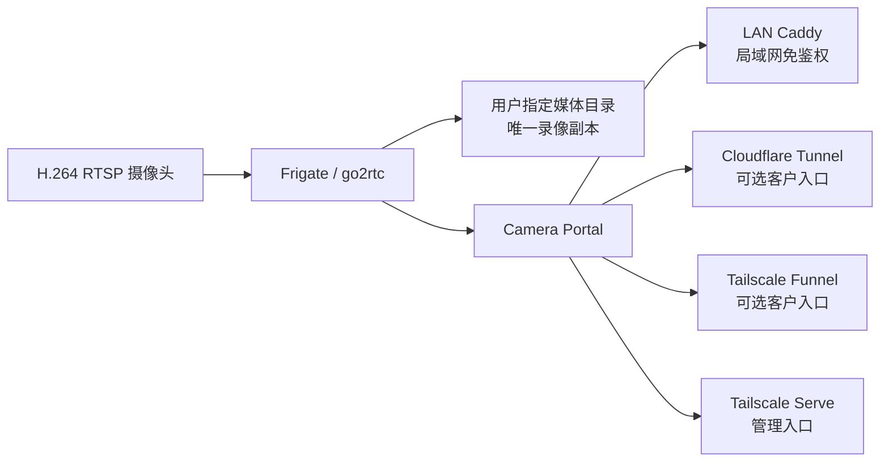

# 360摄像机 NAS 录像与回放方案（支持 RTSP 推流摄像头）

[](https://github.com/Yaro-lu/camare/releases/latest)
[](https://github.com/Yaro-lu/camare/actions/workflows/checks.yml)
[](LICENSE)

Camare 把 H.264 RTSP 摄像头、Frigate、家庭观看网页和可选公网入口整理成一个可重复生成的 Docker Compose 实例。Frigate 负责连续录像、直播和回放；Camera Portal 提供适合手机与电脑的分组双画面；录像始终直接读取同一媒体目录，不复制第二份。

> 正式版本：[`v0.1.0`](https://github.com/Yaro-lu/camare/releases/tag/v0.1.0)。声明式配置、事务更新、健康检查、完整 Git 历史秘密扫描、依赖审查和镜像漏洞门禁均已通过；Linux x86-64 / CPU / 两路合成 H.264 的隔离 Docker E2E 已通过。真实摄像头、Intel VAAPI、NAS 重连、ARM 整栈和跨手机矩阵仍需分别验证。

## 正式版本与下载

推荐从 [GitHub Releases](https://github.com/Yaro-lu/camare/releases/latest) 获取经过标记的正式版本。每个 Release 提供确定性源码归档、`SHA256SUMS`、镜像 digest 清单和独立 SPDX SBOM；Portal 与 LAN Caddy 镜像同时发布到 GHCR，并附构建来源证明。不要从陌生镜像仓库或未经审查的分支部署家庭监控服务。

## 能做什么

- 1–2 个摄像头组，每组 1–2 路画面；客户端同一时间只加载当前组。
- H.264 RTSP 连续录像、直播与时间轴回放，录像保存在用户指定的唯一目录。
- CPU 解码；也提供 Intel VAAPI 配置路径（需在目标主机实机验证）。默认不录音，可按组显式开启新录像音轨。
- 家庭局域网固定 IPv4 免登录观看。
- 可选 Cloudflare Tunnel 或 Tailscale Funnel 公网客户入口。
- 公网模式的设备绑定管理页只通过 Tailscale Serve 暴露。
- 单一实例运行目录，便于在 1Panel 中查看和管理。

## 5 分钟 Quickstart

前提：Linux x86-64、Python 3.10+、Docker Engine、支持 `docker compose up --wait` 的 Docker Compose v2、可写且已挂载的录像目录，以及可从服务器访问的 H.264 RTSP 地址。第一次建议使用 `provider = lan`，公网入口后续再加。

```sh
git clone --branch v0.1.0 --depth 1 https://github.com/Yaro-lu/camare.git
cd camare

# init 不使用 sudo：配置和输入密钥属于当前用户
./install.sh init --config "$PWD/camare.ini"

# 编辑实例、局域网 IP、录像路径、硬件、摄像头和 RTSP 路径
nano camare.ini

# 每个组一个密码文件；不要把密码写进 INI 或命令行
install -m 600 /dev/null secrets/yard-rtsp-password
python3 -c 'from getpass import getpass; from pathlib import Path; Path("secrets/yard-rtsp-password").write_text(getpass("RTSP password: "), encoding="utf-8")'

./install.sh validate --config "$PWD/camare.ini"
./install.sh doctor --config "$PWD/camare.ini"
./install.sh plan --config "$PWD/camare.ini"
sudo ./install.sh apply --config "$PWD/camare.ini" --yes
sudo ./install.sh verify --config "$PWD/camare.ini"
```

`doctor` 是只读检查；普通用户若无 Docker 或目标目录检查权限，可用 `sudo` 重跑。`plan` 只在临时目录渲染并执行 Compose 校验，不修改运行目录。完整的准备、CPU 配置和第二组示例见 [Quickstart](docs/quickstart.md)。

## 架构与入口



| 入口 | 默认绑定方式 | 谁可以访问 |
|---|---|---|
| 局域网观看页 | `http://<lan.bind_ip>:<lan.port>` | 同一可信家庭网内的任何设备；免鉴权 |
| 公网客户页 | `public.origin` | 首次二维码绑定后的客户设备 |
| Portal 管理页 | `admin.origin`，必须为 `*.ts.net` | `admin.tailscale_login` 对应的 Tailscale 用户 |
| Frigate 管理页 | `https://<admin.frigate_bind_ip>:<admin.frigate_port>` | 仅局域网或 Tailscale；使用 Frigate 自身认证 |

`provider = lan` 会关闭 Portal 管理监听器的页面功能，只保留局域网观看。`provider = cloudflare` 或 `tailscale` 时，管理页仍使用 Tailscale Serve；客户入口和管理入口不是同一个安全边界。详见 [LAN](docs/access/lan.md)、[Cloudflare](docs/access/cloudflare.md) 和 [Tailscale](docs/access/tailscale.md)。

## 重要安全警告

- LAN 入口没有用户认证。只绑定服务器真实的 RFC1918 IPv4，绝不能写成全地址端口映射，也不要做路由器端口转发。
- Frigate `5000`、go2rtc `1984`、Portal 管理端和 LAN 端口都不能交给公网 Tunnel/Funnel。
- 摄像头密码和 Cloudflare token 的**输入文件**必须是独立的 `0600` 文件；不要提交到 Git、Issue、截图或日志。运行目录内由 Camare 生成的 LAN 代理共享 key 使用受限的容器组读取权限，具体边界见安全指南。
- 默认不录音。开启 `record_audio = true` 只影响该组之后的新录像，并可能涉及告知、隐私和当地法律义务。
- Camare 不修改路由器、DHCP、DNS、Mihomo、防火墙、IPv6、磁盘分区或挂载配置，也不会删除、移动或复制录像。
- 不要执行 `docker compose down -v`、`docker system prune` 或任何全局清理命令。

完整边界和密钥轮换说明见 [安全指南](docs/security.md)。

## 支持范围

| 项目 | 当前状态 |
|---|---|
| 主机 | Linux x86-64；Python 3.10+；支持 `up --wait` 的 Docker Compose v2 |
| 摄像头 | H.264 RTSP；1–2 组，每组 1–2 路 |
| 解码 | CPU（合成 E2E 已验证）；Intel VAAPI（`i965` / `iHD`，配置支持、需实机验证） |
| 录像 | 现有本地目录或已由系统稳定挂载的 NAS 目录 |
| 公网 | Cloudflare Tunnel 或 Tailscale Funnel；二选一作为客户入口 |
| 管理 | 公网模式下使用 Tailscale Serve |
| 1Panel | 可选；作为生成后单一 Compose 实例的管理界面 |
| ARM / AMD / NVIDIA | 当前发行配置不支持 |
| H.265 | 当前发行配置不支持；不要依赖浏览器偶然可播 |

更细的浏览器、存储、音频和硬件限制见 [兼容性矩阵](docs/compatibility.md)。

## 1Panel 导入

`apply` 会把一个实例生成到唯一目录：

```text
/opt/1panel/docker/compose/camare-<instance-id>
```

Compose project 固定为 `camare_<instance-id>`，基础文件为 `compose.yaml`；Intel VAAPI 还必须同时加载 `compose.intel.yaml`；环境文件为同目录 `.env`。在 1Panel 中导入**这一个现有编排**即可，不要把源码子目录再次导入成多个项目，也不要重新创建第二份媒体卷。

1Panel 各版本对多 Compose 文件导入的支持不同。若界面不能同时选择 Intel override，请继续用 `./install.sh apply`/`status` 管理实例，并只在 1Panel 的“容器”页面观察状态；不要省略 override 后重建 Frigate。生成文件由 `camarectl` 管理，长期配置只改 `camare.ini`，再运行 `plan` 和 `apply`。

`v0.1.0` 同时发布经过漏洞扫描的 GHCR 多架构镜像、digest 和 SBOM；当前一键安装器为了保持生成逻辑与本地配置一致，仍以 `build_mode = local` 从已检出的正式 tag 构建 Portal/Caddy。因此部署后不要删除或移动源码 checkout；需要换位置时先更新部署输入并重新 `plan/apply`。不要手工把 GHCR 镜像替换进生成的 Compose，也不要让 1Panel 另建 project 名，否则 CLI 将无法把它识别为同一实例。

管理页的组级录音滑块会修改当前 Frigate 配置并重启服务；该文件属于受控可变配置，会正常进入备份和回滚。`camare.ini` 仍是下次声明式部署的真相源：若希望设置在后续 `apply` 后继续保留，必须同步修改对应组的 `record_audio`。

## 运维导航

- [升级](docs/operations/upgrade.md)：拉取经过审查的版本、预检、应用和验证。
- [备份与恢复](docs/operations/backup-restore.md)：备份范围、录像和密钥的独立策略。
- [回滚](docs/operations/rollback.md)：自动回滚边界与故障恢复。
- [卸载](docs/operations/uninstall.md)：默认完整保留运行目录，录像永不纳入删除范围。
- [故障排查](docs/troubleshooting.md)：无画面、无录像、Tunnel 1033、VAAPI 等。
- [旧部署迁移](docs/migration-from-legacy.md)：只读基线和受控停机要求。

升级采用逐文件原子替换，并在异常时尝试恢复上一份实例控制文件和容器；它**不是断电原子事务**。录像目录在运行目录外，不参与替换。

## 旧安装器

`deploy.py` 和仓库内旧的多 Compose 目录只为既有部署保留，属于 **legacy**。新安装不要直接运行它；确需维护旧部署时必须显式执行：

```sh
sudo ./install.sh legacy --help
```

现有现网不会在本轮自动迁移。旧栈和新栈绝不能同时共享 Frigate 数据库、Portal 状态或同一媒体写入目录，详见 [从 legacy 迁移](docs/migration-from-legacy.md)。

## 项目状态

- `v0.1.0` 是首个正式公开版本，提供源码归档、校验和、镜像 digest、SBOM 与构建来源证明。
- GitHub Actions 的 Python、Go、Node、配置渲染、依赖审查、完整历史秘密扫描和 HIGH/CRITICAL 镜像漏洞门禁全部通过。
- Linux x86-64 / CPU / 两路合成 H.264 的 Docker 构建、录像、回放、备份、恢复和卸载 E2E 已通过；真实设备与硬件矩阵仍按上面的支持边界单独验收。
- 项目不是 360、Frigate、Cloudflare 或 Tailscale 的官方产品。

许可证见 [LICENSE](LICENSE)，上游组件见 [THIRD_PARTY_NOTICES.md](THIRD_PARTY_NOTICES.md)，变更见 [CHANGELOG.md](CHANGELOG.md)。
