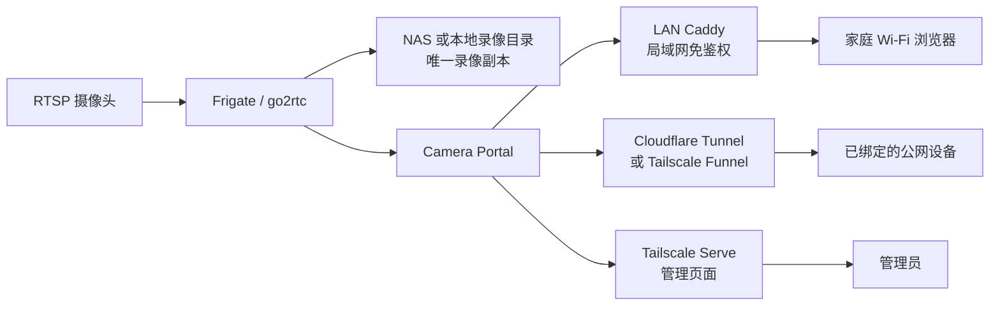

# 360摄像机 NAS 播放回放方案（支持 RTSP 推流的摄像头）

这是一个经过真实家庭服务器验证的自托管摄像头方案：摄像头通过 RTSP 把视频交给 Frigate，Frigate 负责连续录像、索引、直播和回放，Camera Portal 提供适合家人使用的双画面网页。

项目最初用于开启了 RTSP 功能的 360 摄像机，也适用于能够提供稳定 RTSP 地址的其他摄像头。推荐摄像头输出 H.264；H.265 能否直接播放取决于浏览器、go2rtc 和具体设备。

> 本项目不是 360、Frigate、Cloudflare 或 Tailscale 的官方项目。仓库是已运行方案的代码与配置快照，目标是便于自己恢复，也方便有 Linux/Docker 基础的用户照文档部署。

## 最终效果

- 局域网：连接家庭 Wi-Fi 后打开固定 IP，免登录直接看。
- 公网：第一次扫描一次性二维码绑定，后续打开固定网址直接看。
- 默认同时显示两路画面，单击任一路进入全屏。
- 直播和回放都支持双画面；切到回放会停止直播，全屏时停止另一条回放。
- 回放默认跳到约十五分钟前，拖动到录像空档时吸附到最近有录像的位置。
- 管理页按摄像头组显示一次性低清快照，可统一决定各组的新录像是否保留声音。
- 双画面回放默认静音；含音轨的录像可在单画面全屏后手动开启当前一路声音。
- 录像只有一份，Portal 不复制录像文件。
- 管理页只通过 Tailscale Serve 访问，用于生成二维码、查看、重命名和撤销设备。

## 已验证范围

| 项目 | 已验证配置 |
|---|---|
| 摄像头 | 一台摄像头提供两条 RTSP 画面 |
| RTSP 示例 | `/live/101`、`/live/201` |
| 视频 | H.264、1080p、约 12 fps |
| 服务器 | Linux x86-64、Intel 第四代低功耗处理器 |
| 硬解 | `/dev/dri/renderD128`、`i965`、VAAPI |
| Frigate | 0.17.2，固定 tag 和镜像 digest |
| 客户端 | iPhone/iPad Safari、Android、Windows/macOS 常见浏览器 |
| 规模 | 2–3 人偶尔查看，两路直播 |

其他摄像机数量、编码格式、显卡和 ARM 主机需要按 Frigate 官方文档调整，不保证直接照抄即可运行。

## 架构



安全边界：

- Frigate `5000` 和 go2rtc `1984` 只在 Docker 网络中供 Portal 使用。
- Frigate `5000` 是内部免鉴权接口，绝不能直接发布公网。
- Portal 客户入口只绑定宿主机 `127.0.0.1:9080`。
- Portal 管理入口只绑定宿主机 `127.0.0.1:9081`。
- LAN Caddy 只绑定服务器指定的家庭网 IPv4。
- Cloudflare/Tailscale 只连接 Portal，不直接连接 Frigate。

## 目录说明

```text
.
├── deploy.py               # 标准库 Python 交互式安装器
├── install.sh              # Linux 一行启动入口
├── camera-portal/          # Go 门户、设备绑定、直播和回放代理
├── camera-portal-lan/      # 局域网固定 IP 免鉴权入口
├── frigate-1panel/         # Frigate 双画面录像模板
├── examples/cloudflare/    # Cloudflare Tunnel 可选编排
├── tests/                  # 安装器回归测试
├── SECURITY.md             # 公开部署安全注意事项
└── THIRD_PARTY_NOTICES.md  # 上游项目说明
```

三个核心目录仍是独立 Compose 项目，可以分别导入 1Panel，也可以直接使用命令行管理。

## 自动部署（推荐）

自动安装器面向本项目已经验证过的结构：Linux x86-64、Intel VAAPI、一台摄像头提供两条 RTSP 流。它不会尝试自动猜测所有显卡、摄像头协议或 1Panel 版本。

服务器先准备好：

- Docker Engine 和 Docker Compose v2；
- Python 3.10 或更高版本（只使用标准库，不需 `pip install`）；
- Tailscale（公网模式的管理页需要；仅局域网模式可不装）；
- 已挂载且重启后仍存在的录像目录；
- `/dev/dri/renderD128` 或实际 Intel VAAPI render device；
- 摄像头地址、RTSP 用户名/密码及两条 RTSP 路径；
- 使用 Cloudflare 时，从 Zero Trust 复制 remotely-managed Tunnel token。

然后执行：

```sh
git clone https://github.com/Yaro-lu/camare.git
cd camare
sudo ./install.sh
```

脚本会依次询问上述参数，并自动完成：

1. 校验 Linux、root、Docker、服务器局域网 IP 和 VAAPI 设备；
2. 生成四个 Compose 项目的 `.env`；
3. 将摄像头密码和 Cloudflare token 写入权限为 `600` 的 Docker secret 文件；
4. 原子更新 Frigate `config.yml` 中的录像保留天数并保留备份；
5. 生成并同步 Portal/LAN 随机内部密钥；
6. 创建缺失的 Portal 网络和数据目录；
7. 校验 Compose，按 Frigate → Portal → LAN → Cloudflare 顺序启动；
8. 可选配置 Tailscale Serve/Funnel；
9. 检查公网源站和局域网入口健康状态。

现有配置会成为下一次问答的默认值，秘密输入留空即可保留。修改配置前会留下最近三个 `*.bak-*` 备份；秘密文件不会额外复制。

常用模式：

```sh
# 只预览问答和摘要，不写文件、不启动任何服务
python3 deploy.py --dry-run

# 只生成配置，适合随后导入 1Panel；不会启动 Docker/Tailscale
./install.sh --configure-only

# 完成问答后跳过最后一次确认
sudo ./install.sh --yes
```

安装器刻意不会：

- 安装或升级 Docker、1Panel、Tailscale；
- 修改路由器、DHCP、DNS、Mihomo、防火墙或 IPv6；
- 删除、移动或复制任何录像；
- 在外接盘/NAS 未挂载时偷偷改写系统盘；
- 把 Frigate 内部接口、管理入口或 LAN 免鉴权入口发布到公网。

Cloudflare 的 Tunnel token 只能让 `cloudflared` 接入已经创建的 Tunnel。首次部署仍需在 Cloudflare 控制台添加一个 Published application：

```text
公开主机名：你的摄像头域名
服务 URL：http://camera-portal:8080
```

这是 Cloudflare 模式唯一无法仅靠 Tunnel token 安全完成的配置。不要把服务 URL 改成 Frigate `5000`、go2rtc `1984` 或管理端口。

自动部署失败时不会执行 `docker compose down`，也不会删除现有容器、卷或录像。修复提示中的前置条件后重新运行即可。

如果录像路径位于 `/mnt` 或 `/media`，安装器还会确认其最近挂载点不是系统根分区；检测不到独立挂载时直接停止。本地系统盘录像请使用 `/srv/frigate/media` 这类路径。

## 部署前准备

### 服务器

建议最低条件：

- Ubuntu、Debian 或其他支持 Docker 的 64 位 Linux；
- Docker Engine 和 Docker Compose v2；
- 4 GB 内存；
- 一个稳定、启动时自动挂载的录像目录；
- 摄像头和服务器位于可直接互通的局域网；
- 可选 Intel/AMD/NVIDIA 硬件解码设备。

1Panel 不是必须条件。使用 1Panel 时，只把它当作 Compose 管理界面。

### 摄像头

在摄像头 App 中开启 RTSP，并记录：

- 摄像头 IP；
- RTSP 用户名；
- RTSP 密码；
- 主码流/第二画面的 RTSP 路径；
- 摄像头网卡 MAC。

推荐在家庭主路由器中按 MAC 做 DHCP 地址保留。固定地址比每五分钟扫描一次摄像头更稳定，也不会影响全屋网络。

### 端口

默认端口：

| 地址 | 用途 | 是否应公开 |
|---|---|---|
| `127.0.0.1:9080` | Portal 公网源站 | 只交给 Tunnel/Funnel |
| `127.0.0.1:9081` | Portal 管理源站 | 只交给 Tailscale Serve |
| `<LAN_IP>:8088` | 家庭局域网观看 | 仅家庭网 |
| `<ADMIN_IP>:8971` | Frigate 管理页 | 局域网或 Tailscale |
| Docker `frigate:5000` | Frigate 内部 API | 禁止发布 |
| Docker `frigate:1984` | go2rtc 内部 API | 禁止发布 |

## 第一步：下载项目

```sh
git clone https://github.com/Yaro-lu/camare.git
cd camare
```

后续示例假定项目放在：

```text
/opt/1panel/docker/compose/
```

也可以放在其他目录，但不要在多处复制正在运行的配置。

## 第二步：部署 Frigate

进入目录：

```sh
cd frigate-1panel
cp .env.example .env
```

编辑 `.env`：

```dotenv
FRIGATE_CAMERA_HOST=192.168.1.128
FRIGATE_RTSP_USER=admin
FRIGATE_RTSP_PORT=554
FRIGATE_PTZ_PATH=/live/101
FRIGATE_FIXED_PATH=/live/201

FRIGATE_MEDIA_PATH=/srv/frigate/media

FRIGATE_ADMIN_BIND_IP=127.0.0.1
FRIGATE_ADMIN_PORT=8971

FRIGATE_RENDER_DEVICE=/dev/dri/renderD128
LIBVA_DRIVER_NAME=i965

FRIGATE_DOCKER_NETWORK=frigate_default
```

这些地址只是示例。必须换成自己的摄像头、存储路径和服务器地址。

### 保存摄像头密码

不要把密码写进 `.env` 或 `config.yml`：

```sh
mkdir -p secrets
printf '%s' '在这里输入摄像头RTSP密码' > secrets/FRIGATE_RTSP_PASSWORD
chmod 600 .env secrets/FRIGATE_RTSP_PASSWORD
```

该文件已被 `.gitignore` 排除。

### 准备录像目录

```sh
sudo mkdir -p /srv/frigate/media
sudo chmod 755 /srv/frigate/media
```

如果使用外接硬盘或 NAS：

1. 先按 UUID/NFS/SMB 配置系统自动挂载；
2. 重启服务器确认挂载仍然存在；
3. 再在挂载点中创建录像目录；
4. 最后填写 `FRIGATE_MEDIA_PATH`。

Compose 使用 `create_host_path: false`。目标硬盘没有挂载时，Frigate 应启动失败，而不是悄悄回退到系统盘。

Frigate 数据库和配置保存在 `frigate-1panel/config/`，推荐留在本机可靠 SSD；录像才放到大容量磁盘或 NAS。

### 调整录像保留

默认模板：

```yaml
record:
  enabled: true
  continuous:
    days: 0.125
```

`0.125` 约等于三小时，只是测试默认值。修改前先计算两路摄像头每小时实际产生的文件大小。

例如两路合计约 0.75 GiB/小时：

```text
一天约 18 GiB
一周约 126 GiB
```

Frigate 主要按保留时间管理录像。需要绝对容量上限时，应使用独立分区、LVM、磁盘配额或限定大小的文件系统，不要用计划任务直接删除 Frigate 录像文件。

### 启动 Frigate

```sh
docker compose config --quiet
docker compose pull
docker compose up -d
docker compose ps
docker compose logs --tail=200 frigate
```

首次管理员账号：

```text
admin
```

初始随机密码只出现在首次启动日志中：

```sh
docker logs frigate 2>&1 | grep -A1 'User: admin'
```

打开：

```text
https://<FRIGATE_ADMIN_BIND_IP>:<FRIGATE_ADMIN_PORT>/
```

自签名证书产生浏览器警告是正常现象，但不要因此把 Frigate 的内部免鉴权端口发布到公网。

### 检查硬件解码

```sh
ls -l /dev/dri
docker exec frigate ls -l /dev/dri
docker compose logs frigate | grep -Ei 'vaapi|i965|iHD|error|failed'
```

当前模板的 `i965` 只适合较老 Intel 核显。新 Intel 通常使用 `iHD`，NVIDIA、AMD、树莓派和其他 ARM 主机必须参考 Frigate 官方硬件加速文档。

## 第三步：部署 Camera Portal

先确认 Frigate 容器已经运行，并且 Docker 网络存在：

```sh
docker network inspect frigate_default
docker network create camera_portal_tunnel
```

第二条命令如果提示网络已经存在，可以忽略。

进入 Portal：

```sh
cd ../camera-portal
cp .env.example .env
mkdir -p data
sudo chown 65532:65532 data
sudo chmod 750 data
```

生成 LAN 内部密钥：

```sh
openssl rand -hex 32
```

把结果保存到 `camera-portal/.env` 的 `LAN_ACCESS_KEY`，稍后还要把完全相同的值写入 `camera-portal-lan/.env`。该密钥不是给浏览器使用的，只允许 LAN Caddy 向 Portal 证明请求来自固定局域网入口。

编辑：

```dotenv
PUBLIC_BASE_URL=https://camera.example.com
LOCAL_BASE_URL=http://192.168.1.250:8088
LAN_ACCESS_KEY=<刚才生成的64位十六进制字符串>

ADMIN_ORIGIN=https://camera-server.example-tailnet.ts.net:9443
ADMIN_TAILSCALE_LOGIN=you@example.com

RECORDING_TIMEZONE=Asia/Shanghai
CAMERAS=ptz_view=云台画面,fixed_view=枪机画面
CAMERA_GROUPS=yard=院子:ptz_view|fixed_view;front=门前:|

PUBLIC_LOOPBACK_PORT=9080
ADMIN_LOOPBACK_PORT=9081
FRIGATE_DOCKER_NETWORK=frigate_default
PORTAL_INGRESS_NETWORK=camera_portal_tunnel
```

重要规则：

- `PUBLIC_BASE_URL` 只能填写最后实际使用的一个 HTTPS 公网域名。
- 域名改变后，浏览器 Cookie 不会迁移，原有客户设备必须重新绑定。
- `LOCAL_BASE_URL` 必须和 LAN 编排的 IP、端口完全一致。
- `ADMIN_ORIGIN` 必须和 Tailscale Serve 的地址完全一致。
- Frigate 摄像头 ID 必须和 `CAMERAS` 左侧名称一致。
- `CAMERA_GROUPS` 只控制 Tailscale 管理页的分组和组级录音设置。每组固定两个槽，空槽保留为“待接入”；非空 ID 必须已经存在于 `CAMERAS`。

启动：

```sh
chmod 600 .env
docker compose config --quiet
docker compose up -d --build
docker compose ps
curl -fsS http://127.0.0.1:9080/healthz
```

构建阶段会下载固定版本的 Go、hls.js 和 JSMPEG 依赖；运行容器是无 shell 的 `scratch` 镜像。

## 第四步：部署局域网免鉴权入口

进入：

```sh
cd ../camera-portal-lan
cp .env.example .env
```

编辑：

```dotenv
LAN_BIND_IP=192.168.1.250
LAN_PORT=8088
LAN_ACCESS_KEY=<与 camera-portal 完全相同>
PORTAL_INGRESS_NETWORK=camera_portal_tunnel
```

`LAN_BIND_IP` 必须是服务器家庭网网卡真实拥有的 IPv4。不要填摄像头 IP、Tailscale IP、路由器 IP或 `0.0.0.0`。

启动：

```sh
chmod 600 .env
docker compose config --quiet
docker compose up -d --build
./scripts/verify.sh
```

家庭 Wi-Fi 设备打开：

```text
http://192.168.1.250:8088/
```

应直接显示画面，不出现绑定页。该入口不需要改路由器 DNS、DHCP、IPv6 或摄像头网络，也不要求老人安装 Tailscale。

安全提醒：任何能进入家庭局域网的人都可以通过该地址观看监控。绝不能给 `8088` 做公网端口转发。

## 第五步：配置管理入口

当前管理端信任 Tailscale Serve 注入的身份头，因此管理页面仍要求服务器安装 Tailscale。即使客户公网使用 Cloudflare，管理入口也继续使用 Tailscale。

登录服务器的 Tailscale：

```sh
sudo tailscale up
```

将 Portal 管理监听器发布到 tailnet：

```sh
sudo tailscale serve --bg --https=9443 http://127.0.0.1:9081
```

然后把得到的地址写入：

```dotenv
ADMIN_ORIGIN=https://camera-server.example-tailnet.ts.net:9443
ADMIN_TAILSCALE_LOGIN=你的Tailscale登录邮箱
```

修改 `.env` 后重建 Portal：

```sh
docker compose up -d --build
```

管理入口不能使用 Funnel，也不能通过普通 Cloudflare Tunnel 暴露。

## 第六步：选择公网入口

只选择一个公网域名。Cloudflare Tunnel 和 Tailscale Funnel 不要同时作为日常客户入口。

### 方案 A：Cloudflare Tunnel

适合已有 Cloudflare 域名的用户。

1. 在 Cloudflare Zero Trust 中创建 remotely-managed Tunnel。
2. 创建 Published application，例如 `camera.example.com`。
3. 服务地址填写：

   ```text
   http://camera-portal:8080
   ```

4. 使用 `examples/cloudflare/` 中的 Compose 运行连接器。
5. 确认 cloudflared 和 Portal 都加入 `camera_portal_tunnel`。
6. 将 Portal 的 `PUBLIC_BASE_URL` 设置为完全相同的 HTTPS 域名并重建。

连接器部署：

```sh
cd examples/cloudflare
cp .env.example .env
mkdir -p secrets
printf '%s' '从Cloudflare控制台复制的Tunnel token' > secrets/TUNNEL_TOKEN
chmod 600 .env secrets/TUNNEL_TOKEN
docker compose config --quiet
docker compose up -d
docker compose logs --tail=100 cloudflared
```

Tunnel token 等同于密码，任何拿到它的人都可以运行该 Tunnel。不要把 token 写进 Compose、截图、Issue 或 Git。

不要把 Cloudflare 服务地址填成 Frigate `5000`、go2rtc `1984` 或 Frigate 管理端 `8971`。

Cloudflare Tunnel 支持 WebSocket，但 Cloudflare 对 Free/Pro/Business 套餐通过普通 CDN 传送视频或不成比例大文件有单独政策。该方案适合少量、偶尔查看，不能理解为免费无限视频分发。

### 方案 B：Tailscale Funnel

适合没有域名、能够接受 `*.ts.net` 地址和 Funnel 限制的用户。

```sh
sudo tailscale funnel --bg --https=8443 http://127.0.0.1:9080
```

将显示的 HTTPS 地址写入：

```dotenv
PUBLIC_BASE_URL=https://camera-server.example-tailnet.ts.net:8443
```

然后重建 Portal。Funnel 是公网入口，客户不需要安装 Tailscale；Serve 才是仅 tailnet 内访问的管理入口。

Funnel 仍处于 beta，有固定端口和不可调整的带宽限制，更适合少量临时访问。

## 第七步：绑定客户设备

1. 使用自己的 Tailscale 账号打开管理页。
2. 单击“生成绑定二维码”。
3. 每个二维码只给一台设备使用。
4. 客户用微信、QQ 等扫描时，页面会提示转到默认浏览器。
5. 成功绑定后，日常直接打开 `PUBLIC_BASE_URL`，不要反复扫描旧二维码。

绑定信息保存在浏览器 Cookie 中。下列操作会要求重新绑定：

- 清除网站数据或 Cookie；
- 使用无痕模式；
- 更换浏览器；
- 更换公网域名；
- 管理员撤销设备；
- 丢失或替换 Portal 的 `data/state.json`。

## 1Panel 部署方式

推荐在 1Panel 的“容器 → 编排”中按顺序管理：

1. `frigate-1panel/docker-compose.yml`
2. `camera-portal/compose.yaml`
3. `camera-portal-lan/compose.yaml`
4. 可选 `examples/cloudflare/compose.yaml`

每个编排的工作目录必须是对应文件所在目录，否则 `.env`、相对卷和 Docker secret 路径会失效。

使用自动安装器时，Compose 文件和目录结构完全相同。脚本不会调用版本相关的 1Panel 私有 API；部署完成后容器会立即出现在 1Panel 容器列表中。如需在“编排”页接管，请导入上述现有 Compose 文件和工作目录，不要再创建一套同名服务。

不要让 1Panel 自动改写以下安全绑定：

```text
127.0.0.1:9080
127.0.0.1:9081
<LAN_BIND_IP>:8088
<ADMIN_BIND_IP>:8971
```

特别不要把它们简化成 `0.0.0.0` 或只写端口。

## 备份

### 必须备份

停止或暂停写入后，备份：

```text
camera-portal/.env
camera-portal/data/
camera-portal-lan/.env
frigate-1panel/.env
frigate-1panel/secrets/
frigate-1panel/config/
```

其中包含密码、设备绑定令牌哈希、Frigate 数据库和认证状态，必须加密保存，不能提交到 GitHub。

自动安装器生成的 `*.bak-*` 也可能包含旧 `.env`，同样属于敏感配置；它们已被 Git 忽略，脚本只保留每个文件最近三份。

### 录像

录像只存在 `${FRIGATE_MEDIA_PATH}`。默认备份配置时不要再复制一份录像；需要灾难恢复时，应单独使用 NAS 快照、磁盘镜像或异地备份策略。

### GitHub 备份能恢复什么

本仓库能恢复：

- Portal 源码与网页；
- Docker 编排；
- Frigate 配置模板；
- LAN 入口；
- 部署步骤和故障排查方法。

本仓库不能恢复：

- 摄像头真实密码；
- Cloudflare Tunnel token；
- 已绑定设备；
- Frigate 管理密码和数据库；
- 历史录像。

## 恢复顺序

1. 恢复录像盘并确认挂载。
2. 克隆本仓库。
3. 恢复 Frigate `.env`、secret 和完整 `config/`。
4. 启动 Frigate，确认两路 RTSP 和历史录像。
5. 恢复 Portal `.env` 和 `data/`。
6. 启动 Portal。
7. 恢复 LAN `.env` 并启动 Caddy。
8. 恢复 Tailscale Serve。
9. 恢复 Cloudflare Tunnel 或 Tailscale Funnel。
10. 分别验证局域网、公网、管理页、直播和回放。

如果没有恢复 `camera-portal/data/state.json`，服务仍可运行，但所有公网设备都要重新生成二维码绑定。

## 更新

更新前：

```sh
git pull --ff-only
```

先备份 Portal `data/` 和 Frigate `config/`。Frigate 数据库可能随版本迁移，因此不要只回退镜像而不恢复对应数据库备份。

Portal：

```sh
cd camera-portal
docker compose up -d --build
```

LAN：

```sh
cd camera-portal-lan
docker compose up -d --build
```

Frigate：

1. 阅读目标版本 release notes；
2. 修改 tag 和 digest；
3. 备份 `/config`；
4. `docker compose pull && docker compose up -d`；
5. 验证直播、录像、回放和 Portal；
6. 失败时同时恢复旧镜像和旧 `/config`。

不要直接把固定镜像改成长期跟随 `stable` 或 `latest`。

## 摄像头 IP 变化

首选路由器 DHCP 地址保留。作为备选：

```sh
cd frigate-1panel
```

在 `.env` 填写：

```dotenv
CAMERA_MAC=真实摄像头MAC
CAMERA_SUBNET=192.168.1
```

运行：

```sh
./find-camera-ip.sh
```

脚本只扫描指定 `/24` 子网，不适合跨 VLAN、多网段或 IPv6 摄像头。

## 常见问题

### Frigate 登录失败

确认使用首次启动日志里的随机密码：

```sh
docker logs frigate 2>&1 | grep -A1 'User: admin'
```

不要把摄像头密码误当成 Frigate 管理密码。

### 两路摄像头都没有画面

检查：

```sh
docker compose logs --tail=200 frigate
docker exec frigate wget -qO- http://127.0.0.1:1984/api/streams
```

重点确认摄像头 IP、RTSP 账号密码、路径、端口和服务器到摄像头的路由。

### 只有一路黑屏

分别验证 `/live/101` 和 `/live/201`。某些型号只有一条 RTSP 流，或者第二条路径代表子码流而不是第二画面，需要修改 Frigate 和 Portal 摄像头列表。

### iPhone 回放正常但直播黑屏

本项目对 iPhone/iPad 使用 Frigate JSMPEG WebSocket，其他浏览器优先使用 MSE/WebRTC。确认 Cloudflare/Tailscale 没有阻断 WebSocket，并检查 Portal、Frigate、go2rtc 三方日志。

### 回放第一次加载慢

Portal 会按时间范围向 Frigate 请求录像片段。家庭上行、Tunnel 节点、硬盘随机读取和录像片段数量都会影响首帧。拖动后的请求已经限制预缓冲并复用一小时播放窗口。

### 公网很慢，局域网正常

说明 Frigate 和摄像头大概率正常，瓶颈在家庭上行或公网 Tunnel/Funnel。先单路测试，再检查 Cloudflare 节点、Tailscale DERP、摄像头码率和服务器出口。

### 局域网出现绑定页

检查：

- `LOCAL_BASE_URL` 与 `LAN_BIND_IP:LAN_PORT` 是否完全一致；
- 两个 `.env` 的 `LAN_ACCESS_KEY` 是否完全相同；
- Caddy 和 Portal 是否都在 `camera_portal_tunnel`；
- 是否通过正确的局域网 IP 访问。

### 已绑定设备突然失效

检查浏览器是否清除了 Cookie、是否进入无痕模式、公网域名是否更换，以及管理员是否撤销设备。正常页面访问会自动续期，二维码只负责第一次兑换。

### 录像写到了系统盘

立即检查：

```sh
findmnt
docker inspect frigate
df -h
```

外接盘挂载点必须先存在。不要通过创建一个同名普通目录“修复”启动失败，否则可能继续写满根分区。

### CPU 温度高

先确认硬件解码实际生效，再检查持续转码、目标检测、直播消费者数量、风道和散热。不要仅凭存在 `/dev/dri` 就认定 ffmpeg 已经使用核显。

## 安全检查清单

- [ ] 没有把 `.env`、密码、Tunnel token、`state.json` 或 `frigate.db` 提交到 Git。
- [ ] 摄像头默认密码已经更换。
- [ ] `5000`、`1984`、`8554` 没有发布公网。
- [ ] Portal 管理端只绑定 `127.0.0.1` 并通过 Tailscale Serve。
- [ ] LAN Caddy 只绑定家庭网 IPv4。
- [ ] 路由器没有给 `8088` 做端口转发。
- [ ] 公网只有一个规范 HTTPS 域名。
- [ ] Cloudflare/Tailscale secret 文件权限为 `600`。
- [ ] Frigate `/config` 与录像目录有独立备份策略。
- [ ] 更新前已经备份 Frigate 数据库。

更多说明见 [SECURITY.md](SECURITY.md)。

## 已知限制

- 管理页依赖 Tailscale Serve；Cloudflare 模式也仍需要 Tailscale 管理入口。
- LAN 入口故意免鉴权，接入家庭网络即具备观看权限。
- 默认只配置两路画面，摄像头 ID 固定为 `ptz_view`、`fixed_view`。
- 自动安装器当前只自动校验 Intel VAAPI；其他显卡应按手动部署章节调整。
- 该 Portal 不负责转码；浏览器兼容性取决于摄像头编码和 Frigate/go2rtc。
- Cloudflare 普通套餐的视频交付政策和 Tailscale Funnel 带宽限制都可能影响长期、高码率观看。
- 这是家庭少量用户方案，不是商业多租户视频平台。

## 上游资料

- [Frigate 安装](https://docs.frigate.video/frigate/installation/)
- [Frigate 硬件加速](https://docs.frigate.video/configuration/hardware_acceleration_video/)
- [Frigate 录像配置](https://docs.frigate.video/configuration/record/)
- [Frigate 鉴权](https://docs.frigate.video/configuration/authentication/)
- [Cloudflare Tunnel](https://developers.cloudflare.com/tunnel/)
- [Cloudflare 视频交付政策](https://developers.cloudflare.com/fundamentals/reference/policies-compliances/delivering-videos-with-cloudflare/)
- [Tailscale Serve](https://tailscale.com/docs/features/tailscale-serve)
- [Tailscale Funnel](https://tailscale.com/docs/features/tailscale-funnel)

## 项目状态

该仓库以“可恢复、可部署、可参考”为目标。自动安装器覆盖上方“已验证范围”，不追求无条件适配所有摄像头和硬件。提交问题时请隐藏公网域名、Tailscale 地址、摄像头账号、MAC、日志中的 token 和家庭网络信息。
